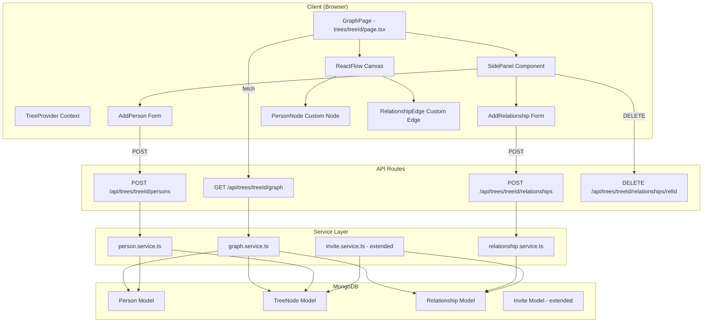
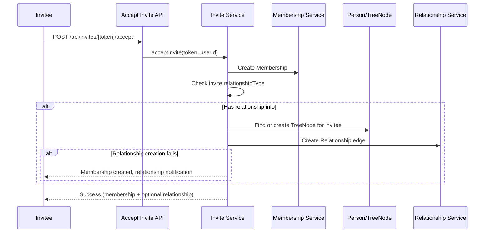

# Design Document: Family Tree Graph

## Overview

This design describes the interactive family tree graph visualization feature. The system renders person nodes and relationship edges on a React Flow canvas with dagre-based hierarchical layout. Users can pan, zoom, and click nodes to view details in a side panel. Admins can add profile-only nodes and define relationships. The invite system is extended to capture relationship type at creation time and auto-create edges on acceptance.

The architecture follows the existing patterns: server-side data fetching via API routes backed by service functions, client-side rendering with React context, and MongoDB/Mongoose for persistence. The graph is a client component that receives data from an API endpoint and manages its own layout and interaction state.

## Architecture



**Key architectural decisions:**

1. **Single graph data endpoint**: A dedicated `GET /api/trees/[treeId]/graph` endpoint returns all nodes and relationships in one request, avoiding waterfall fetches. The service joins TreeNode + Person data server-side.

2. **Client-side layout computation**: Dagre layout runs in the browser after data fetch. This keeps the server stateless regarding visual positioning and allows instant re-layout when relationships change without a round-trip.

3. **Derived relationships computed client-side**: Sibling, grandparent, uncle/aunt, and cousin relationships are derived by traversing the relationship graph in the browser. This avoids storing redundant data and ensures derived relationships are always consistent with the current edge set.

4. **Existing models reused**: The Person, TreeNode, and Relationship Mongoose models already exist with the correct schema. No model changes are needed for core graph functionality. Only the Invite model needs a minor extension for relationship capture.

## Components and Interfaces

### API Endpoints

#### `GET /api/trees/[treeId]/graph`

Returns all active tree nodes (with person data) and relationships for the graph.

```typescript
// Response shape
interface GraphResponse {
  nodes: GraphNodeData[];
  relationships: GraphRelationshipData[];
}

interface GraphNodeData {
  id: string;           // TreeNode._id
  personId: string;
  firstName: string;
  lastName?: string;
  dateOfBirth?: string; // ISO date
  dateOfDeath?: string; // ISO date
  gender?: string;
  profilePhotoUrl?: string;
  linkedUserId?: string;
}

interface GraphRelationshipData {
  id: string;           // Relationship._id
  fromNodeId: string;   // TreeNode._id of fromPerson
  toNodeId: string;     // TreeNode._id of toPerson
  type: 'parent_child' | 'spouse';
}
```

#### `POST /api/trees/[treeId]/persons`

Creates a profile-only person node. Admin-only.

```typescript
// Request body
interface CreatePersonRequest {
  firstName: string;      // required, 1-100 chars
  lastName?: string;      // optional, 1-100 chars
  dateOfBirth?: string;   // ISO date
  dateOfDeath?: string;   // ISO date
  gender?: 'male' | 'female' | 'other' | 'prefer_not_to_say';
}

// Response: GraphNodeData (the newly created node)
```

#### `POST /api/trees/[treeId]/relationships`

Creates a relationship between two persons. Admin-only.

```typescript
// Request body
interface CreateRelationshipRequest {
  fromNodeId: string;     // TreeNode._id (parent or spouse A)
  toNodeId: string;       // TreeNode._id (child or spouse B)
  type: 'parent_child' | 'spouse';
}

// Response: GraphRelationshipData
```

#### `DELETE /api/trees/[treeId]/relationships/[relationshipId]`

Soft-deletes a relationship. Admin-only.

### Client Components

#### `FamilyTreeGraph` (main graph component)

Wraps React Flow with dagre layout. Manages:
- Fetching graph data from the API
- Computing dagre layout positions
- Rendering custom nodes and edges
- Handling node click → side panel open
- Handling pan/zoom interactions

```typescript
interface FamilyTreeGraphProps {
  treeId: string;
  currentUserId: string;
  role: MembershipRole;
}
```

#### `PersonNode` (custom React Flow node)

Renders a person's name (truncated), avatar, and highlighted border for current user.

```typescript
interface PersonNodeData {
  firstName: string;
  lastName?: string;
  profilePhotoUrl?: string;
  linkedUserId?: string;
  isCurrentUser: boolean;
}
```

#### `SidePanel`

Slides in from the right on node click. Displays person details, direct relationships (grouped), derived relationships (labeled), and admin actions.

```typescript
interface SidePanelProps {
  node: GraphNodeData | null;
  relationships: GraphRelationshipData[];
  allNodes: GraphNodeData[];
  isAdmin: boolean;
  onClose: () => void;
  onNavigateToNode: (nodeId: string) => void;
  onRelationshipCreated: (rel: GraphRelationshipData) => void;
  onRelationshipDeleted: (relId: string) => void;
}
```

### Service Functions

#### `graph.service.ts`

```typescript
export async function getGraphData(treeId: string): Promise<GraphResponse>;
```

Fetches all active TreeNodes (joined with Person) and active Relationships for the tree. Maps Relationship.fromPersonId/toPersonId to their corresponding TreeNode IDs for the client.

#### `person.service.ts`

```typescript
export async function createProfileOnlyPerson(
  treeId: string,
  data: CreatePersonRequest,
  actorUserId: string
): Promise<GraphNodeData>;
```

Creates a Person record and a TreeNode with `linkedUserId: null`. Validates admin role, input constraints, and records audit fields.

#### `relationship.service.ts`

```typescript
export async function createRelationship(
  treeId: string,
  data: CreateRelationshipRequest,
  actorUserId: string
): Promise<GraphRelationshipData>;

export async function deleteRelationship(
  treeId: string,
  relationshipId: string,
  actorUserId: string
): Promise<void>;
```

Creates/soft-deletes relationships. Validates: admin role, both nodes exist in tree, no self-relationship, no duplicate of same type, and for spouse type normalizes direction.

### Utility Functions

#### `layout.ts` — Dagre layout computation

```typescript
import type { Node, Edge } from '@xyflow/react';

export function computeDagreLayout(
  nodes: Node[],
  edges: Edge[],
  options?: { rankdir?: 'TB' | 'LR'; nodesep?: number; ranksep?: number }
): { nodes: Node[]; edges: Edge[] };
```

Pure function. Takes React Flow nodes/edges, runs dagre, returns nodes with computed positions.

#### `derived-relationships.ts` — Relationship derivation

```typescript
export type DerivedRelationType =
  | 'sibling'
  | 'half-sibling'
  | 'grandparent'
  | 'grandchild'
  | 'uncle_aunt'
  | 'cousin';

export interface DerivedRelationship {
  nodeId: string;
  personName: string;
  type: DerivedRelationType;
}

export function deriveRelationships(
  personNodeId: string,
  relationships: GraphRelationshipData[],
  nodes: GraphNodeData[]
): DerivedRelationship[];
```

Pure function. Traverses the relationship graph to compute extended family connections.

#### `format-name.ts` — Name display formatting

```typescript
export function formatDisplayName(firstName: string, lastName?: string): string;
```

Pure function. Combines first + last name, truncates with ellipsis if combined length exceeds 30 characters.

#### `group-relationships.ts` — Direct relationship grouping

```typescript
export interface GroupedRelationships {
  parents: GraphNodeData[];
  children: GraphNodeData[];
  spouses: GraphNodeData[];
}

export function groupDirectRelationships(
  personNodeId: string,
  relationships: GraphRelationshipData[],
  nodes: GraphNodeData[]
): GroupedRelationships;
```

Pure function. Groups a person's direct relationships by type for side panel display.

## Data Models

### Existing Models (No Changes)

**Person** — Already has firstName, lastName, dateOfBirth, dateOfDeath, gender, profilePhotoId, createdBy, timestamps, soft-delete fields.

**TreeNode** — Already has personId, treeId, linkedUserId, displayPosition, addedBy, addedAt, soft-delete fields. The `displayPosition` field stores default positions but the graph uses dagre-computed positions at runtime.

**Relationship** — Already has treeId, fromPersonId, toPersonId, type (`parent_child` | `spouse` | `sibling`), direction, createdBy, timestamps, soft-delete fields. Unique index on `{treeId, fromPersonId, toPersonId, type, deletedAt}` prevents duplicates.

### Invite Model Extension

The Invite model needs three optional fields to capture relationship information:

```typescript
// Additional fields on IInvite
interface IInviteRelationship {
  relationshipType?: 'parent_child' | 'spouse';
  targetPersonNodeId?: Types.ObjectId;  // TreeNode._id the invitee relates to
  inviteeIsParent?: boolean;            // For parent_child: true if invitee is parent
}
```

These fields are optional — existing invites without relationship info continue to work as before. On invite acceptance, if these fields are populated, the system creates a TreeNode for the invitee (if not already present) and a Relationship edge.

### Data Flow on Invite Accept (Extended)



## Correctness Properties

*A property is a characteristic or behavior that should hold true across all valid executions of a system — essentially, a formal statement about what the system should do. Properties serve as the bridge between human-readable specifications and machine-verifiable correctness guarantees.*

### Property 1: Layout Hierarchy Invariant

*For any* valid family tree graph (set of nodes and parent-child edges), after computing the dagre layout, every parent node SHALL have a y-position strictly less than (above) all of its child nodes.

**Validates: Requirements 1.2**

### Property 2: Name Truncation Correctness

*For any* first name and optional last name string combination, the `formatDisplayName` function SHALL return the full combined name when its length is ≤ 30 characters, and SHALL return a string of exactly 30 characters ending with "…" when the combined name exceeds 30 characters.

**Validates: Requirements 1.5**

### Property 3: Direct Relationship Grouping Completeness

*For any* person node and set of relationships in a tree, the `groupDirectRelationships` function SHALL partition all direct relationships of that person into exactly three groups (parents, children, spouses) such that every relationship involving that person appears in exactly one group, and no relationship not involving that person appears in any group.

**Validates: Requirements 3.2**

### Property 4: Whitespace-Only Names Are Rejected

*For any* string composed entirely of whitespace characters (spaces, tabs, newlines), the person creation validation SHALL reject it as an invalid first name, and the person record SHALL not be created.

**Validates: Requirements 4.4**

### Property 5: Duplicate Relationship Detection

*For any* two distinct person nodes in a tree and any relationship type, if a non-deleted relationship of that type already exists between them, attempting to create another relationship of the same type between the same pair SHALL result in a conflict error, regardless of direction.

**Validates: Requirements 5.5**

### Property 6: Derived Relationship Computation Correctness

*For any* family tree graph structure with parent-child edges, the `deriveRelationships` function SHALL correctly compute:
- Siblings as persons sharing at least one parent (full siblings share both parents, half-siblings share exactly one)
- Grandparents as parents of parents (exactly 2 hops up via parent-child edges)
- Grandchildren as children of children (exactly 2 hops down)
- Uncles/aunts as siblings of parents
- Cousins as children of parents' siblings

Such that every derived relationship returned is reachable via the specified traversal path, and no reachable relationship of these types is omitted.

**Validates: Requirements 7.1, 7.2, 7.3**

## Error Handling

| Scenario | Response | User Experience |
|----------|----------|----------------|
| Graph data fetch fails | 500 from API | Error message with retry button on graph canvas |
| Person creation with invalid input | 400 with field-level errors | Inline form validation errors |
| Person creation by non-admin | 403 Forbidden | Toast notification "Only admins can add people" |
| Relationship creation with self-reference | 400 Validation Error | Form error "Cannot create relationship with self" |
| Duplicate relationship | 409 Conflict | Form error "This relationship already exists" |
| Relationship creation by non-admin | 403 Forbidden | Toast notification "Only admins can manage relationships" |
| Invite accept with relationship — target deleted | Membership created, relationship skipped | Notification "Relationship could not be created automatically" |
| Invite accept with relationship — duplicate | Membership created, relationship skipped | Notification "Relationship already exists" |
| Node click with slow network | Side panel opens with skeleton | Loading indicator until data arrives |

**Error handling principles:**
- Membership creation during invite accept MUST NOT fail due to relationship creation failure (graceful degradation)
- All write operations validate admin role server-side regardless of client UI state
- Soft-delete is used for relationships (never hard delete) to maintain audit trail
- API errors return structured JSON with `code` and `message` fields matching existing error utility patterns (`ValidationError`, `ForbiddenError`, `ConflictError`, `NotFoundError`)

## Testing Strategy

### Unit Tests (Vitest)

Focus on pure logic functions with example-based tests:

- `formatDisplayName` — specific examples for short names, exactly 30 chars, over 30 chars
- `computeDagreLayout` — specific tree shapes verify correct positioning
- `groupDirectRelationships` — specific relationship sets verify correct grouping
- `deriveRelationships` — specific family structures verify correct derivation
- Component rendering — PersonNode, SidePanel, AddPerson form, AddRelationship form
- Role-based UI visibility — admin vs non-admin button rendering
- Edge styling — parent-child (solid + arrow) vs spouse (dashed, no arrow)

### Property-Based Tests (Vitest + fast-check)

The project will use [fast-check](https://github.com/dubzzz/fast-check) for property-based testing with Vitest.

**Configuration:**
- Minimum 100 iterations per property test
- Each test tagged with: `Feature: family-tree-graph, Property {N}: {title}`

**Properties to implement:**

1. **Layout Hierarchy Invariant** — Generate random DAGs (nodes + parent-child edges), compute layout, assert all parents have y < children y-positions.

2. **Name Truncation Correctness** — Generate arbitrary strings for firstName/lastName, verify truncation rules hold.

3. **Direct Relationship Grouping Completeness** — Generate random relationship sets, verify partition correctness.

4. **Whitespace Name Rejection** — Generate whitespace-only strings, verify all are rejected.

5. **Duplicate Relationship Detection** — Generate random node pairs + types, create relationship, attempt duplicate, verify conflict.

6. **Derived Relationship Computation** — Generate random multi-generation family graphs, verify traversal-based derivation matches expected results.

### Integration Tests

- API route tests for `/api/trees/[treeId]/graph`, `/persons`, `/relationships`
- Invite acceptance with relationship capture (happy path + failure resilience)
- Authorization checks (admin vs non-admin for all write endpoints)

### Smoke Tests

- `npm install` resolves without peer dependency conflicts
- React Flow renders without errors with empty data
- Zoom constraints (minZoom=0.1, maxZoom=4) are configured correctly
